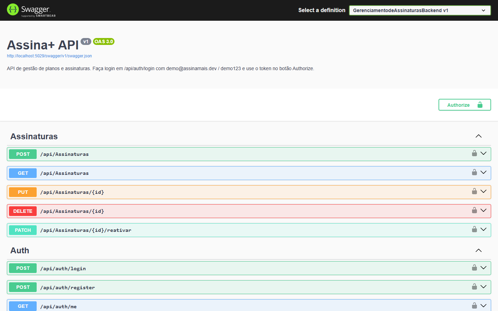
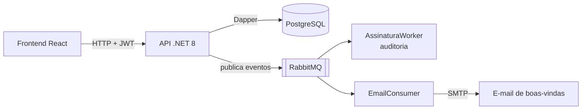

# Assina+ · API

[](https://github.com/jessicaccl/gerenciamento-de-assinaturas-backend/actions/workflows/ci.yml)


API REST do **Assina+**, um sistema de gestão de planos e assinaturas recorrentes. Ela cuida de autenticação, cadastro de planos, ciclo de vida das assinaturas e eventos assíncronos (auditoria e e-mail de boas-vindas) via RabbitMQ.

> Interface web: [gerenciamento-de-assinaturas-frontend](https://github.com/jessicaccl/gerenciamento-de-assinaturas-frontend) (com prints de todas as telas)



## Rodando em 1 minuto

Pré-requisito: [Docker](https://www.docker.com/) instalado.

```bash
docker compose up -d --build
```

Pronto. O comando sobe o PostgreSQL (já com tabelas e dados de exemplo), o RabbitMQ e a API.

| Serviço | Endereço |
|---|---|
| Swagger (documentação interativa) | http://localhost:5029/swagger |
| Painel do RabbitMQ | http://localhost:15672 (guest / guest) |

**Contas de demonstração**

| Perfil | E-mail | Senha |
|---|---|---|
| Admin | `demo@assinamais.dev` | `demo123` |
| Colaborador | `colaborador@assinamais.dev` | `demo123` |

> Já tem um PostgreSQL usando a porta 5432? Rode `DB_PORT=5434 docker compose up -d --build`.

## Arquitetura



Organização em camadas, inspirada em Clean Architecture:

```
GerenciamentodeAssinaturasBackend/
├── Controllers/          # Endpoints HTTP
├── Application/          # DTOs, interfaces e serviços (auth, e-mail, mensageria)
├── Domain/               # Entidades e contratos de repositório
├── Infrastructure/       # Acesso a dados com Dapper
├── BackgroundServices/   # Consumidores do RabbitMQ
└── Templates/            # Template HTML do e-mail
db/init.sql               # Estrutura do banco + dados de demonstração
```

## Stack

- **.NET 8 / C#** com ASP.NET Core Web API
- **Dapper** + **PostgreSQL** para acesso a dados com SQL explícito
- **RabbitMQ** para eventos assíncronos (auditoria e e-mails)
- **JWT** para autenticação stateless e **BCrypt** para hash de senhas
- **xUnit**, **FluentAssertions** e **WebApplicationFactory** para testes
- **Docker Compose** e **GitHub Actions** (CI)

## Endpoints

| Método | Rota | Acesso | Descrição |
|---|---|---|---|
| POST | `/api/auth/register` | Público | Cria conta (perfil Colaborador) e dispara e-mail de boas-vindas |
| POST | `/api/auth/login` | Público | Retorna o token JWT |
| GET | `/api/auth/me` | Autenticado | Dados do usuário logado |
| POST | `/api/auth/validate-password` | Autenticado | Confirma a senha antes de ações críticas |
| GET | `/api/planos` | Autenticado | Lista planos |
| POST / PUT | `/api/planos` | **Admin** | Cria ou edita plano |
| DELETE | `/api/planos/{id}` | **Admin** + senha | Remove plano sem assinaturas vinculadas |
| GET / POST / PUT | `/api/assinaturas` | Autenticado | Lista, cria e edita assinaturas |
| DELETE | `/api/assinaturas/{id}` | Autenticado | Inativa assinatura |
| PATCH | `/api/assinaturas/{id}/reativar` | Autenticado | Reativa assinatura |
| GET | `/api/usuario` | Autenticado | Lista usuários (sem hash de senha nem documentos) |
| PUT | `/api/usuario/{id}` | Próprio usuário ou Admin | Edita dados; só Admin altera cargo |
| DELETE | `/api/usuario/{id}` | **Admin** | Remove usuário |

## Mensageria

Toda operação relevante publica um evento em uma fila do RabbitMQ:

| Fila | Conteúdo |
|---|---|
| `emails_queue` | Pedidos de envio de e-mail (boas-vindas) |
| `auth_eventos` | Logins realizados |
| `usuarios_eventos` | Cadastro, edição e remoção de usuários |
| `planos_eventos` | Alterações no catálogo de planos |
| `assinaturas_eventos` | Novas assinaturas, cancelamentos e reativações |

Os consumidores tentam reconectar automaticamente enquanto o broker não está disponível, então a API não cai se o RabbitMQ demorar a subir.

## Decisões técnicas

- **Dapper em vez de EF Core**: SQL explícito e mais controle sobre as consultas, num domínio pequeno.
- **DTOs de resposta**: a API nunca devolve `SenhaHash` ou documentos pessoais.
- **Autorização por perfil**: `[Authorize(Roles = "Admin")]` nas ações administrativas, com o cargo vindo do próprio token.
- **Confirmação de senha** para excluir planos, como proteção extra contra cliques acidentais.
- **Erros sem vazamento**: exceções inesperadas viram um `500` genérico no formato ProblemDetails, e os detalhes ficam só no log.
- **Configuração fora do código**: chave JWT, banco, RabbitMQ e SMTP vêm de `appsettings` ou de variáveis de ambiente.

## Testes

São testes de integração (requisições HTTP reais contra a API) e testes unitários de regras de negócio. Eles cobrem CRUD de planos, ciclo de vida da assinatura, cálculo de expiração e regras de segurança (401/403 e ausência de dados sensíveis nas respostas).

Com o `docker compose` rodando:

```bash
dotnet test
```

> Se você subiu o banco com `DB_PORT=5434`, defina antes a variável `ConnectionStrings__DefaultConnection="Host=localhost;Port=5434;Database=assina_mais;Username=postgres;Password=postgres;"`.

## Deploy gratuito

O projeto está preparado para rodar em planos gratuitos:

| Parte | Serviço | Observação |
|---|---|---|
| Banco | [Neon](https://neon.tech) (PostgreSQL) | Execute `db/init.sql` no SQL Editor do Neon |
| API | [Render](https://render.com) | Use o `render.yaml` (New > Blueprint) |
| Mensageria (opcional) | [CloudAMQP](https://www.cloudamqp.com) | Sem ela, os eventos vão só para o log (`RabbitMQ__Habilitado=false`) |
| Frontend | [Vercel](https://vercel.com) | Veja o README do frontend |

No Render, informe:
- `ConnectionStrings__DefaultConnection`: a URL do Neon, no formato `postgresql://...`. A API converte automaticamente.
- `Cors__Origens__0` e `App__UrlFrontend`: a URL do frontend na Vercel.

A chave JWT é gerada pelo próprio Render. No plano gratuito, a API "dorme" após 15 minutos sem uso, e a primeira requisição pode levar até 1 minuto. As contas de demonstração são protegidas contra edição e exclusão (`App:ContasProtegidas`).

## Rodando sem Docker

1. Instale o .NET 8 SDK, o PostgreSQL e o RabbitMQ.
2. Crie o banco `assina_mais` e execute `db/init.sql`.
3. Ajuste `appsettings.Development.json` se o seu usuário ou senha do Postgres forem diferentes.
4. Rode `dotnet run --project GerenciamentodeAssinaturasBackend`.

### Envio de e-mail (opcional)

Sem configuração de SMTP, o e-mail de boas-vindas aparece apenas no log. Para enviar de verdade, use [User Secrets](https://learn.microsoft.com/aspnet/core/security/app-secrets) e nunca coloque a senha no código:

```bash
cd GerenciamentodeAssinaturasBackend
dotnet user-secrets set "Email:Remetente" "seu-email@gmail.com"
dotnet user-secrets set "Email:Senha" "sua-senha-de-app"
```

---

Desenvolvido por **Jessica Lima** · [GitHub](https://github.com/jessicaccl)
